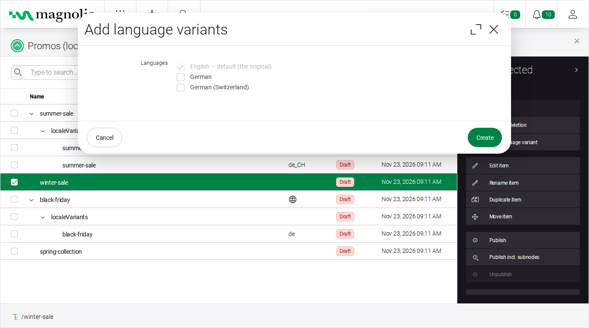
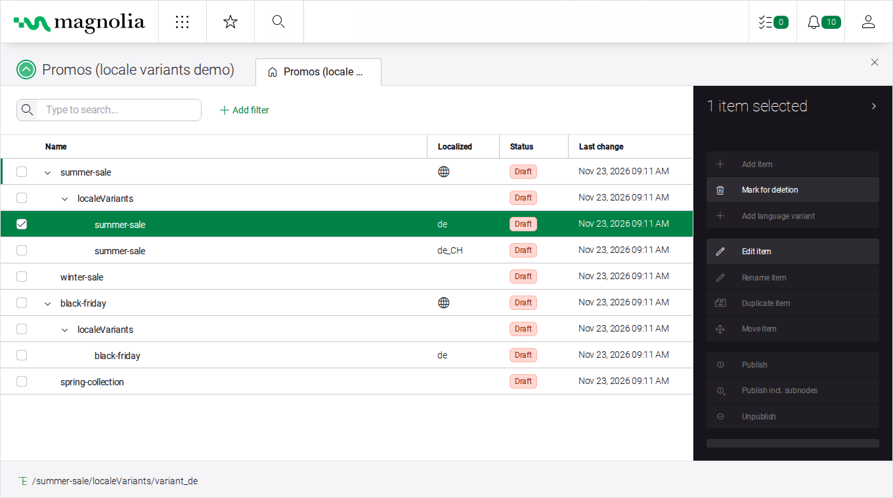
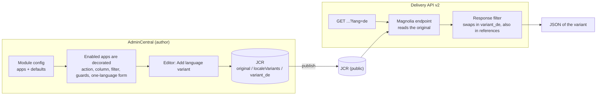

# Node Locale Variants for Magnolia

A Magnolia 6.4 module that lets a page or a content item have a **separate copy per language**. Each copy has its own lifecycle: it is edited, versioned and published on its own, and the Delivery API serves it in place of the original.

> Status: version `0.2.0`, distributed from this repository ([dist/](dist/)). Built and tested on Magnolia CE 6.4.10, Java 17 or later.

## What it does

Magnolia translates content **property by property**: `title`, `title_de`, `title_fr`, and all of them live on the same node. Every language of a node is therefore forced to have the same structure, components and publication state.

To go beyond this limit, the module adds **locale variants**. A page or a content item can be fully localized by creating a locale variant node for a specific language. In that language it can then have different components on a page, a different set of fields filled in, and a separate review and publication flow.

```
# Example: the nodes of a promo with two locale variants.

summer-sale                 the original node, with the properties title, title_de, ...
└── localeVariants          the container node of its variants
    ├── variant_de          the German variant node, with title (in German) and no title_de
    └── variant_de_CH       the Swiss German variant node
```

### What editors get

In the content apps where locale variants are enabled:

- **"Add language variant"** action on eligible nodes (pages, content items): pick the languages, and each variant starts as a copy of the original with that language's values.
- A variant is **edited in one language**, with the same form as its original.
- Variants have their own lifecycle. They are **published, versioned, deleted and restored on their own**. They can't be renamed, moved, copied or duplicated, so they stay where the module finds them.
- A **"Localized" column** shows which items have variants (are localized), and which variant belongs to which language.
- A **"Localized" filter** lists all localized items (the ones with variants).





### What developers get

**In the front end**

- **The same requests.** The Delivery API serves the variant in place of the original when the request asks for that language (`?lang=de` or `Accept-Language`), for single nodes, for children (`@nodes`) and for **referenced nodes at any depth**.
  
  - **What changes in the response:** it is the variant node itself, with its property values. Note that `@name`, `@path` and `@id` are the variant's, not the original's. A front end that builds links or keys from the name or the path has to take that into account.
  
    ```json
    {
      "@name": "variant_de",
      "@path": "/summer-sale/localeVariants/variant_de",
      "@id": "3071fb5b-84e0-448b-af5d-c0ec903e6042",
      "@nodeType": "lvd:promo",
      "title": "Sommerschlussverkauf",
      "cta": "Zum Angebot"
    }
    ```
  
- **Magnolia's language fallback.** A request for `de_CH` gets `variant_de_CH`, else `variant_de`, else the original.

  ```
  GET /.rest/delivery/promos/summer-sale            -> the original
  GET /.rest/delivery/promos/summer-sale?lang=de    -> variant_de
  GET /.rest/delivery/promos/summer-sale?lang=de_CH -> variant_de_CH, else variant_de
  ```

**In Magnolia**

- **Nothing to change in your apps.** An app gets locale variants with a few lines of configuration: its definition files stay as they are, and an app left out of the configuration is not touched.
- **Variants are ordinary nodes.** Publishing, versioning, export and access control work on them as on any node, with Magnolia's own commands and actions.
- **Configuration at runtime.** A change of the module configuration applies in a few seconds, without a restart.
- **Extension points.** The rules for copying an original into a variant and for finding a variant are Magnolia components that a project can replace.

## How to set it up

**Requirements:** Magnolia 6.4.x, Java 17, a site definition with more than one locale.

**1. Add the module to your local Maven repository.** Open a terminal in the folder [dist/mgnl-node-locale-variants-0.2.0/](dist/mgnl-node-locale-variants-0.2.0/). Then install the jar, its pom and the sources with the following command:

```
mvn install:install-file -Dfile=mgnl-node-locale-variants-0.2.0.jar -DpomFile=mgnl-node-locale-variants-0.2.0.pom -Dsources=mgnl-node-locale-variants-0.2.0-sources.jar
```

For more details, and for the command to use in Windows PowerShell, see [INSTALL.md](dist/mgnl-node-locale-variants-0.2.0/INSTALL.md).

**2. Add the module to your project.** Add the following Maven dependency:

```xml
<dependency>
  <groupId>io.github.giufaz</groupId>
  <artifactId>mgnl-node-locale-variants</artifactId>
  <version>0.2.0</version>
</dependency>
```

On the next start Magnolia installs the module `node-locale-variants` and registers its two node types (`lv:localeVariants`, `lv:localeVariant`). Nothing changes in your apps until you enable them.

**3. Enable your content apps.** The module has one config file, which you change with a decoration in your own module (Maven or light module): `<your-module>/decorations/node-locale-variants/config.yaml`.

```yaml
apps:
  promos:                     # the app name
    nodeTypes: [myns:promo]   # the item types that can have variants
```

That is enough for a content-types app and for most hand-written content apps. The change applies in a few seconds, without a restart.

**4. Options.** All optional:

```yaml
defaults:
  # Browser actions allowed on variants and on variants containers, for every app
  variantActions: [editItem, confirmMarkDeletion, markDeleted, activate, deactivate, export, ...]
  containerActions: [activate, deactivate, export, ...]
  # "Restore previous version" also restores the container and the variants under the restored item
  recursiveRestore: true
  # Experimental, see below
  experimentalVariantDialogs: false

apps:
  ctas:
    enabled: true                         # false = the app stays as it is
    nodeTypes: [myns:ctaLink, myns:ctaSocial]
    variantActions: [editLink]            # added to the defaults (your app's own action names)
    containerActions: []
    replaceDefaultContainerActions: true  # true = exactly this list, not added to the defaults
```

Things to know:

- An action that is not in the lists is disabled on variants and containers. If your app names its edit action differently from `editItem`, add it to `variantActions`.
- Copy, move, duplicate, rename and paste are never allowed on variants and containers, whatever the lists say: this protects the node structure the module relies on.

**5. Delivery.** Nothing to configure: the module acts on every Delivery API v2 endpoint (`jcrDeliveryEndpoint_v2`, `jcrPagesDeliveryEndpoint_v2`) and on their JCR reference resolvers (`jcrReferenceResolver`). Publish the original, its container and its variants to see them on the public instance ("Publish incl. subnodes" does it in one step).

**Experimental: dialogs and the Pages app.** The module can also show a variant in one language in Vaadin dialogs (`openDialogAction`, page properties) and in the page editor. This part is exploratory and off by default: turn it on with `defaults.experimentalVariantDialogs: true` to try it out. The module ships a preset for the Pages app (`apps.pages-app`, off by default), which needs it. See [Known limits and risks](docs/known-limits-and-risks.md).

## How it works



Three parts, independent of each other:

1. **A data model in JCR.** Variants are ordinary nodes under their original, of the same type, marked with a mixin. Publishing, versioning, export and access control work on them as on any node.
2. **A decoration of the content apps you enable.** The module changes the app definitions at runtime, the way a YAML decoration would. Your app definitions are not touched, and an app left out of the config stays as it is.
3. **A response filter on the Delivery API.** Magnolia's endpoint does its work, then the filter replaces the node it found with its variant for the requested language.

Details, flows and what to expect on Magnolia updates: [Module architecture](docs/module-architecture.md).

## Demo and tests

- **Demo.** The repository has a demo module with sample apps, Delivery endpoints, a page template and a small front end for the page editor. See [Demo](docs/demo.md).
- **Integration tests.** About a hundred scenarios against the REST API and the AdminCentral UI, on a fresh Magnolia in Docker: `integration-tests/run.sh`. They are also the quickest way to get a running demo (`integration-tests/run.sh --keep`). See [integration-tests/](integration-tests/README.md).

## Roadmap

- [Known limits and risks](docs/known-limits-and-risks.md)
- [Planned improvements](docs/planned-improvements.md)
