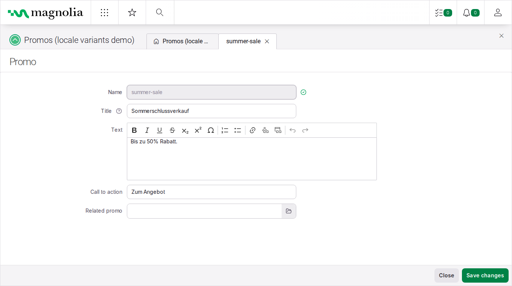
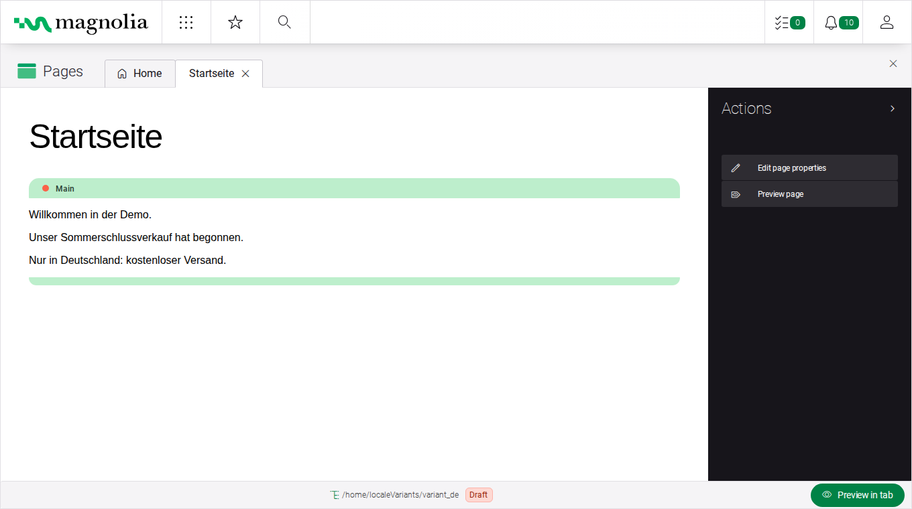

# Demo

The module `mgnl-node-locale-variants-demo` (folder [demo/](../demo)) has everything needed to try locale variants on a Magnolia instance. It is also what the [integration tests](../integration-tests/README.md) run against.

> **Never install the demo on a production instance.** It has a REST endpoint that runs Groovy scripts (`/.rest/lv-demo/groovy`), used by the tests to create content.

## What is in it

| What | Where | Shows |
|---|---|---|
| Site definition `demo` | `sites/demo.yaml` | Three locales: `en` (default), `de`, `de_CH` |
| App "Promos" | `contentTypes/promo.yaml`, `apps/promos.yaml` | A content-types app with locale variants, default action lists |
| App "Promos, hand-written" | `apps/promosHandWritten.yaml` | A hand-written app, default action lists |
| App "CTAs" | `apps/ctas.yaml` | A hand-written app with four item types: three enabled, each with its own edit action (two detail sub-apps, one dialog), one left out |
| App "Promos, nested fields" | `apps/promosNested.yaml` | A form with i18n fields at every level of nesting (composite, multi-value, switchable): a variant's form is in one language at every level |
| App "Promos, not enabled" | `apps/promosStock.yaml` | An app on the same workspace that is **not** in the module config: it stays as Magnolia shows it |
| Pages app | `templates/pages/basic.yaml`, `dialogs/pageProperties.yaml`, `templates/components/text.yaml` | The module's Pages preset turned on (experimental), a page template with page properties and a text component. Only in the demo, "Add page" is allowed on page variants, to show what a page under a variant looks like |
| Front end | `webresources/frontend/index.html` | One HTML file that shows a demo page in the page editor |
| Delivery endpoints | `restEndpoints/delivery/` | `/.rest/delivery/promos`, `/.rest/delivery/promosdeep` (nested references), `/.rest/delivery/pages` |
| Module config | `decorations/node-locale-variants/*.config.yaml` | One file per app, and `dialogs.config.yaml`, which turns on the experimental one-language dialogs |

## Run it

**With Docker (quickest).** The integration tests start a fresh Magnolia CE with the module and the demo installed, and can leave it running:

```
integration-tests/run.sh --keep
```

When the run ends, Magnolia is on `http://localhost:8064/magnoliaAuthor` (and `/magnoliaPublic`), user `superuser`, password `superuser`, with the test content in the apps. Stop it with `docker compose -f integration-tests/env/docker-compose.yml down`.

**On your own Magnolia 6.4 webapp** (the Community Edition is enough), with Maven and Java 17:

1. Build both modules:

   ```
   mvn -DskipTests package
   ```

2. Copy the module jar (`module/target/mgnl-node-locale-variants-<version>.jar`) and the demo jar (`demo/target/mgnl-node-locale-variants-demo-<version>.jar`) into `WEB-INF/lib` of the author webapp, and of the public webapp to try the Delivery API on public.
3. Start Magnolia and let it install the two modules. The demo ships no content: create it as described below.

## Try it

**A content item**

1. Open the app **Promos**, add an item (e.g. `summer-sale`) and give it a title in English and in German.
2. Select it and click **Add language variant**. Check "German" and click "Create".
3. The tree now shows `summer-sale / localeVariants / summer-sale`, with `de` in the "Localized" column of the variant and an icon on the original.
4. Open the variant with **Edit item**: the form has one language, the German title is in "Title", and the name can't be changed.
5. Select the original and click **Publish incl. subnodes**.
6. Ask the Delivery API:

   ```
   GET /.rest/delivery/promos/summer-sale            -> "@name": "summer-sale"
   GET /.rest/delivery/promos/summer-sale?lang=de    -> "@name": "variant_de"
   GET /.rest/delivery/promos/summer-sale?lang=de_CH -> "@name": "variant_de" (fallback)
   ```



**A page** (experimental)

1. Open the app **Pages**, add a page with the template "Basic page".
2. Select it, click **Add language variant** and create the German variant.
3. Open the variant with **Edit page**: the demo's front end shows it in the page editor, without a language switch. Add a "Text" component: its dialog has one language.


