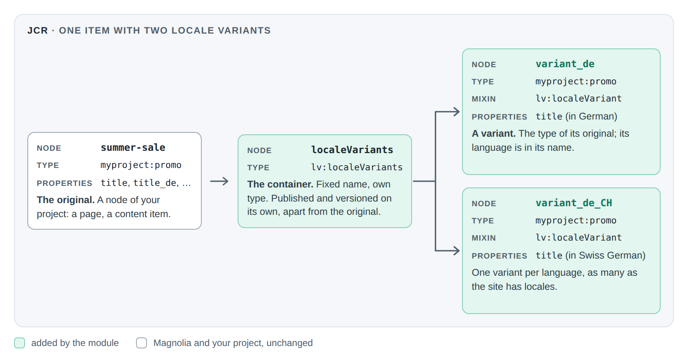
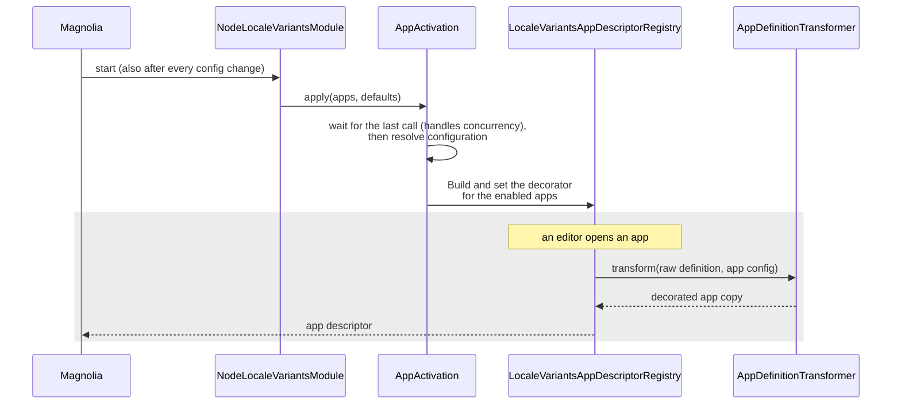
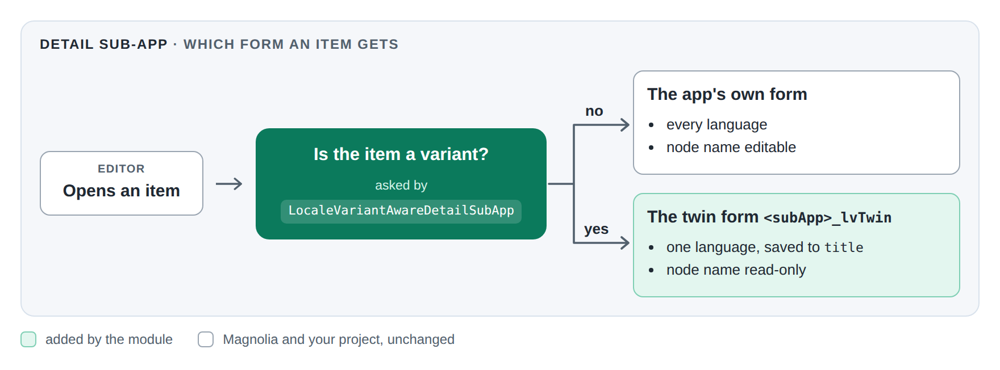
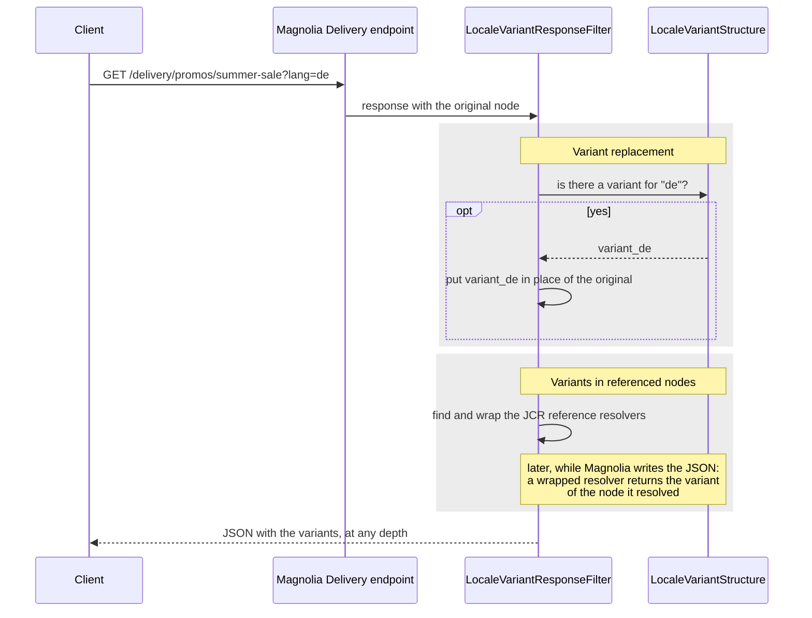

# Module architecture

How the module works inside, for developers who want to extend it, debug it or judge what a Magnolia update means for it. For installation and configuration see the [README](../README.md).

## The idea

The module has three parts that don't depend on each other:

| Part | Package | What it does |
|---|---|---|
| Data model | `com.giufaz.magnolia.localevariants` | Where variants live in JCR, how they are found and created |
| Content apps | `...localevariants.app` | Decorates the enabled apps: actions, column, filter, guards, one-language form |
| Delivery | `...localevariants.delivery` | Serves the variant in place of the original in the Delivery API v2 |

You could even use the data model and the Delivery part without enabling any app (creating variants from your own code with `LocaleVariantCreator`), and the apps without any Delivery endpoint.

## Data model

- **The original** is any versionable node: a page, a content item.
- **The container** `localeVariants` has a fixed name and its own type, `lv:localeVariants`. It extends `mgnl:content`, so it is published and versioned on its own, apart from the original.
- **A variant** `variant_<locale>` has the primary type of its original, so every form, template and endpoint made for the original works on it. It is told apart by the mixin `lv:localeVariant`; its language is in its name.

Two classes hold this knowledge, and everything else goes through them:

- `LocaleVariantStructure`: names and types, which variant serves a language (`variant_de_CH`, else `variant_de`, else the original, as Magnolia's i18n fallback), which nodes can have variants.
- `LocaleVariantCreator`: copies the original into a variant. Properties and child nodes are copied, except child pages, items and folders; for every i18n property, at every level of nesting, the value of the variant's language becomes the base value (`title_de` becomes `title`) and the other languages are dropped.

Both are Magnolia components: a project can replace them in its module descriptor, for example to change what is copied.

**Publishing.** Variants and containers are ordinary nodes, so Magnolia's publishing, versioning, deletion and export work on them unchanged. "Publish" on an original publishes the original only; "Publish incl. subnodes" publishes its container and variants too. Creating the first variant marks a published original as modified, because the container is a new child.

## Content apps

### Activation

- The module config (`config.yaml`, changed by decoration) is read into `NodeLocaleVariantsModule`. Magnolia restarts the module when the config changes, so a change applies without a restart of the instance.
- `LocaleVariantsAppDescriptorRegistry` takes the place of Magnolia's app registry (type mapping in the module descriptor). It behaves like the original, and decorates the definitions of the enabled apps on the way out.
- `AppDefinitionTransformer` works on the raw definition (the YAML as a map), the same steps as a YAML decoration. The app's own files are never changed, and an app that is not in the config is returned as it is.

**What the transformer adds to an enabled app:**

| In the browser | How |
|---|---|
| Container and variants show in the tree | `lv:localeVariants` added to the datasource's `allowedNodeTypes` |
| "Add language variant" | Action `addLocaleVariant`, opening the dialog `addLocaleVariants` |
| Actions disabled on variants and containers | Availability rule `LocaleVariantRule` on every action, driven by the action lists of the config |
| No drag and drop of or onto variants | `LocaleVariantDropConstraint` around the tree's own constraint |
| "Localized" column and filter | `LocalizedColumnDefinition`; a filter on the child `localeVariants` |
| Restore brings back the variants too | The restore action becomes Magnolia's recursive one (`defaults.recursiveRestore`) |

### Editing a variant

- For every detail sub-app the transformer adds a **twin**, `<subApp>_lvTwin`: the same form with the node name read-only and the fields no longer i18n, at every level of nesting (fields inside composite, multi-value and switchable fields included).
- `LocaleVariantAwareDetailSubApp` is set as the sub-app's class. It creates the sub-app's original class (Magnolia's or the project's own) and gives it the twin definition when the item is a variant.
- The values are therefore read from and saved to the base properties of the variant (`title`), and saving can't rename the variant.

**Dialogs and the page editor (experimental).** Vaadin dialogs and the page editor have no sub-app definition to twin. `LocaleVariantI18nAuthoringSupport` wraps Magnolia's authoring support in the sub-apps: for a variant, or a node under one, it answers with one locale and the base property names. It is off unless `defaults.experimentalVariantDialogs` is on, and has known defects: see [Known limits and risks](known-limits-and-risks.md).

## Delivery

- `LocaleVariantResponseFilter` is a JAX-RS response filter bound to the Delivery API v2. It runs after Magnolia's endpoint and before the response is written as JSON.
- It swaps a single node or the children of a node (`@nodes`). Query results are left alone.
- **References:** nodes referenced by the served node are resolved later, while the JSON is written. The filter wraps the endpoint's JCR reference resolvers (`LocaleVariantAwareReferenceResolverWrapper`), so a referenced original is replaced by its variant too, at any depth.
- **Pages:** a page variant gets its missing area nodes, as Magnolia's pages endpoint does for a page.
- **It steps aside** when the request has no language, asks for `lang=all` or for a version, and for page editor requests on the author instance, where the editor must get the page it opened.
- If anything fails while swapping, the response stays as Magnolia built it.

## Magnolia updatability

How much a Magnolia update can affect the module. The assessment comes from comparing the Magnolia sources the module builds on across the 6.2, 6.3 and 6.4 lines (up to 6.4.10); it is a reading of the code, not a guarantee.

**In short:** most of the module sits on public APIs that have not changed since 6.2 or 6.3. One point relies on a Magnolia internal and is guarded; a few others are worth a look when a new minor version comes out.

**A new patch release (6.4.x) is low risk.** Between 6.3.1 and 6.4.10 none of the Magnolia signatures the module uses changed, apart from the move from `javax` to `jakarta` in 6.4.

**A new minor or major line needs a check.** The few real API breaks found in the history all happened between 6.2 and 6.3. The module is built for 6.4 (`jakarta`), so it does not run on 6.3 as it is.

### Stable ground

| What the module builds on | History |
|---|---|
| Definition decoration (`DefinitionDecorator`, `DefinitionProvider`, raw definition views) | Unchanged since 6.2 |
| Sub-apps, actions, availability rules, drop constraints, columns, field factories | Unchanged since 6.2, or only additions |
| Delivery API reference resolvers and endpoint filtering (`ReferenceResolver`, `ConfiguredFiltering`) | Unchanged since 6.2 |
| i18n and sites (`I18nContentSupport`, `SiteManager`), JCR node types and utilities | Unchanged since 6.3, source-compatible before |
| The data model | Plain JCR nodes and a mixin: no Magnolia API involved |

### Points to watch

| Point | Why | Risk of change | What happens if it breaks |
|---|---|---|---|
| **A private class of the Delivery endpoint**, matched by name, to tell which reference resolvers are JCR resolvers | An internal: Magnolia can rename it at any time. It has not changed from REST 2.2 to 4.0 | Medium | Checked at every start: the module logs an ERROR, references are served as out of the box, everything else keeps working. The check is one component a project can replace |
| **React forms (Warp)**: the module resets the form's remembered language on a variant | A new module of the 6.4 line, an internal state holder | Medium | Where the class is missing the module skips this step |
| **The app registry is replaced** by a subclass, through a type mapping in the module descriptor | The methods used are public and unchanged since 6.2, but the registry's parent class was rewritten in 6.3. Another module mapping the same type would conflict | Low | The module logs an ERROR and the apps stay undecorated |
| **Magnolia's decoration plumbing** (building a provider from a raw definition) | Public classes, unchanged since 6.2, but not documented as extension API | Low | Apps stay undecorated |
| **Order of the Delivery response filters** | The module's filter has a fixed place among Magnolia's own response filters; the order is a number, not a contract, and Magnolia's i18n filter changed its number between patch releases. The module's number (5500) leaves room on both sides, between Magnolia's 6000 and 5001 | Low | A variant could be served differently from an original (e.g. its properties not localized). Covered by the integration tests |
| **The browser filter "Localized"** | Relies on Magnolia's naming convention for filters on a child node, present since 6.3 | Low | The filter stops working; the rest of the app is unaffected |

The module uses no reflection to call or change Magnolia's private members. The only reflective code looks whether a class exists (the Warp forms, the Pages REST module) and reads the field types of the one internal class above, to verify it at startup.

### What to do on a Magnolia update

1. Run the integration tests against the new version: `MGNL_VERSION=<version> integration-tests/run.sh`. They cover the points above, and fail on any WARN or ERROR of the module in the Magnolia log.

Or by hand:

1. Start the instance and look for ERROR or WARN lines with `[node-locale-variants]` in the log.
2. Open an enabled app: "Add language variant" is there, a variant opens in one language.
3. Ask the Delivery API for an item with a variant and a referenced item with a variant, with `?lang=`.
